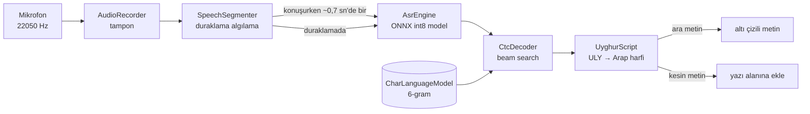

# Sesle yazma nasıl çalışıyor?

## 1. Kayıt — `AudioRecorder.kt`

- Model **22050 Hz** sesle eğitildi ve modelin içindeki mel ön-işleme de bu hızı varsayıyor. Bu yüzden önce 22050 Hz deneniyor.
- Cihaz bu hızı desteklemiyorsa 44100, 48000 ya da 16000 Hz ile kaydediliyor ve `Resampler` ile 22050'ye çevriliyor.
- Kaynak `VOICE_RECOGNITION`; ses tanıma için ayarlıdır, ağır efektler uygulamaz.
- Tampon kayıt sürerken okunabiliyor; en fazla 5 dakika tutuyor.

## 2. Parçalama — `asr/SpeechSegmenter.kt`

Model çift yönlü (BiGRU), yani cümlenin sonunu görmeden kelime kelime çıktı veremiyor. Bunun yerine akış parçalara bölünüyor:

- Ses 20 ms'lik çerçevelere ayrılıyor ve her çerçevenin enerjisi hesaplanıyor.
  - Gürültü tabanı sessiz çerçevelere göre uyarlanıyor.
  - Tabanın ~9 dB üstündeki çerçeveler "konuşma" sayılıyor.
- **Ara sonuç:** Konuşma sürerken, mevcut parça her ~0,7 saniyede baştan tanınıyor ve altı çizili (*composing*) metin olarak gösteriliyor.
  - Son kelime gösterilmiyor, çünkü genelde hâlâ söyleniyor.
  - Böylece gösterilen kelimelerin sonradan değişme oranı %12'den %6'ya iniyor.
- **Kesin sonuç:** Konuşmadan sonra ~1 saniye sessizlik olunca parça son kez tanınıp yazılıyor; yeni parça başlıyor.
  - Konuşmanın sonundan 0,4 saniye fazladan alınıyor ki kelime sonları kırpılmasın.
  - 0,5 saniyelik eşik, kelime arasındaki düşünme duraklamalarında cümleyi ~3 parçaya bölüyordu ve hatayı artırıyordu. Kelime hata oranı %19,5'ten %17,1'e indi.
- **Sınır:** Parça 15 saniyeyi geçerse son 3 saniyenin en sessiz noktasından kesiliyor. Böylece tanıma süresi sınırlı kalıyor.

## 3. Model — `AsrEngine.kt`

- `uyghur_asr_int8.onnx` dosyası, ~70M parametre:
  - 2B konvolüsyonlar
  - 2 adet çift yönlü GRU
  - 1B residual konvolüsyonlar
  - CTC çıktısı
- Ses seviyesini normalleştirme ve mel spektrogram hesaplama modelin içinde. Uygulama ham sesi veriyor.
- Çıktı: her ~18 ms için 34 sembolün olasılığı. Semboller: boş (blank), `a…z`, boşluk, `é ö ü`, `’`.
- int8 dönüşümünde yalnız konvolüsyonlar küçültüldü. Mel katmanı float kaldı; o da küçültülürse model bozuluyor.

## 4. Çözme — `asr/CtcDecoder.kt`, `asr/CharLanguageModel.kt`

- **CTC prefix beam search**, 16 aday ile.
- Her adayın puanı: `log P(ses) + 0.3 · log P(dil modeli) + 1.0 · uzunluk`
- **Karakter 6-gram dil modeli:** THUYG-20 metinlerinden kuruldu (`tools/export_char_lm.py`). Modelin akustik olarak kararsız kaldığı yerlerde (ör. e/i/u) gerçek Uygurca yazımı seçtiriyor.

## 5. Yazı — `asr/UyghurScript.kt`

Latin harfli Uygurca (ULY) → Arap harfli Uygurca (UEY):

- `ch, gh, sh, zh, ng` tek harf sayılıyor. Araya kesme işareti girerse ayrılıyor (`n’g` → نگ).
- Ünlüyle başlayan heceye hemze (ئ) ekleniyor:
  - kelime başında (`öy` → ئۆي)
  - kesmeden sonra (`mu’ellim` → مۇئەللىم)
  - iki ünlü arasında (`aile` → ئائىلە)

## Testler

`app/src/test/` içindeki birim testleri `asr/` paketinin tamamını kapsıyor:
- yazı dönüşümü
- CTC çözme
- dil modeli normalizasyonu
- yeniden örnekleme
- duraklama algılama

Testler her Actions derlemesinde çalışıyor (`./gradlew testDebugUnitTest`).
